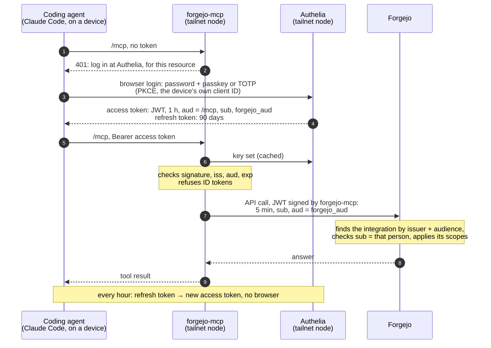

# Forgejo MCP server

[forgejo-mcp](https://git.b4mad.industries/agentic-forges/forgejo-mcp) gives coding
agents Forgejo's issues, pull requests, files and Actions runs as tools. It runs here,
next to [Forgejo](../forgejo), and agents reach it over the tailnet. Built from the
mirror at `git.insuit.cz/tools-mirror/forgejo-mcp`.

It holds no Forgejo token. Each agent logs in at [Authelia](../authelia) as a person,
and the server acts on Forgejo as that person, through a Forgejo *Authorized
Integration* that only accepts JWTs this server signed for them. That is upstream's
`resource-server` mode; its guide is
[operator.md](https://git.b4mad.industries/agentic-forges/forgejo-mcp/src/branch/main/docs/oauth-resource-server/operator.md).

## How a call is authorised



What each piece holds, and what it takes to steal it:

| Piece | Holds | Leaked means |
|---|---|---|
| A device | refresh token (90 days), access token (1 h) | acting as me until that device's client is deleted, and only from the tailnet |
| forgejo-mcp | the signing key, `secrets/signing.pem` | acting as everyone whose integration trusts it — guard it like an admin token |
| Authelia | users, password hashes, `forgejo_aud`, its own signing key | minting tokens for anyone in `users.yml` |
| Forgejo | each person's integration: issuer, audience, `sub` rule, scopes | — the integration is the permission boundary |

Cutting access off:

- **One device** — delete its client in [`../authelia/configuration.yml`](../authelia/configuration.yml)
  and restart Authelia. Its refresh token stops at once; its access token lasts at most
  an hour. Removing the device from the tailnet stops even that.
- **Everything of mine** — delete my Authorized Integration in Forgejo (Settings →
  Applications). Forgejo then refuses every JWT for it, now.
- **The signing key** — see [CAVEATS.md](CAVEATS.md#the-signing-key).

## Who can reach it

No port is published on the Pi. The server listens on the loopback of a Tailscale
sidecar, its own tailnet node `forgejo-mcp`, tagged `tag:forgejo-mcp`. The ACL in
[`pollos/infra/tailscale.tf`](../pollos/infra/tailscale.tf) lets my devices in and keeps
the pollos boxes out — jesse runs arbitrary CI jobs. The login makes reaching it no
longer enough, but there is no reason to hand CI a door to try.

The sidecar also runs an HTTP proxy on its loopback: with userspace networking it is
the only way forgejo-mcp reaches Authelia's node.

## Setup

Authelia first, see [../authelia](../authelia/README.md#setup). Then, on the Pi:

```bash
cp .env.example .env   # set the tailnet names
make key               # the signing key, made here and printed nowhere
make up                # builds the image on first run
```

`TS_AUTHKEY` is needed for the first `make up` only, from
`make -s forgejo-mcp-authkey` in `pollos/infra`; the sidecar's state volume keeps
the node after that.

Forgejo must allow this issuer: set `FORGEJO_MCP_HOST` in `../forgejo/.env` and run
`make up` there. Then check the documents Forgejo will fetch:

```bash
curl -sS https://forgejo-mcp.<tailnet>.ts.net/issuer/.well-known/openid-configuration
curl -sS https://forgejo-mcp.<tailnet>.ts.net/issuer/jwks.json
curl -sS -o /dev/null -w '%{http_code}\n' -X POST https://forgejo-mcp.<tailnet>.ts.net/mcp   # 401
docker exec forgejo wget -qO- https://forgejo-mcp.<tailnet>.ts.net/issuer/jwks.json  # Forgejo reaches it too
```

Then each person's integration: `make integration USER=<name>` in `../authelia`.

Clients use `https://forgejo-mcp.<tailnet>.ts.net/mcp` as a streamable-HTTP MCP
server, with their device's client ID:

```bash
claude mcp add --transport http --client-id forgejo-mcp-<device> --callback-port 53682 \
  forgejo https://forgejo-mcp.<tailnet>.ts.net/mcp
```

The entries are in `landsman/config`.

Upgrade: Renovate opens the bump; after merging, copy `compose.yml` to the Pi and
run `make build up`. What to know before that is in [CAVEATS.md](CAVEATS.md).

`FORGEJO_MCP_ALLOW_FILE_PATH_UPLOAD` stays unset. It lets attachment tools upload
files from the server's filesystem, and here that is the Pi.

## Ports

None on the Pi. The server listens on 8080 and the proxy on 1055, both inside the
sidecar's network namespace; the sidecar serves 8080 on 443 of its own tailnet node.
