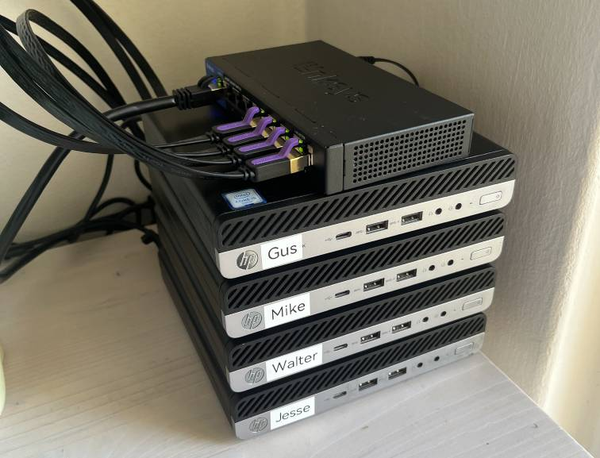

# Pollos

pollos is my homelab — a small cluster of Debian 13 boxes where every node is named after a Breaking Bad character (walter, jesse, mike, gus…). 
Pretty hostnames make each box easy to spot and a joy to SSH into. 
The scripts in [setup](setup) folder take a fresh Debian install and turn it into another member of the family.

You can easily install them from microsite: https://www.pollos.cz

Everything around the boxes — DNS, the microsite, health tunnels, uptime
monitors and the Tailscale tailnet — is Terraform in [infra](infra/README.md),
applied by CI on merge. The same health tunnel and monitor cover the Raspberry
Pi [nas](../nas/README.md), which runs its connector alongside its main tunnel;
[setup/003-monitoring.sh](setup/003-monitoring.sh) sets it up on every host. That
README also holds the credential list and the runbooks for enrolling a box.

A box that is to run a Docker Swarm stack gets one more step,
[setup/006-swarm.sh](setup/006-swarm.sh) — only that box, and it does nothing if the box is already
in a swarm. It computes the address to advertise rather than taking it as an argument, because
`--advertise-addr eno1` is refused on these boxes: the interface carries two IPv6 addresses and the
daemon will not choose between them.

The boxes boot into the `powersave` CPU governor; [setup/governor.sh](setup/governor.sh) `install` pins them to `performance` across reboots (`sudo governor powersave` to back off).

## HW

Five mini PCs, each with 32 GB of DDR4 SO-DIMM (2x 16 GB) running at the most its CPU takes.

| Node   | Machine                | CPU                          | RAM                 | Disk                            |
|--------|------------------------|------------------------------|---------------------|---------------------------------|
| gus    | HP ProDesk 600 G3 Mini | i5-6500T, 4C/4T, 2.5–3.1 GHz | DDR4-2133, Kingston | 240 GB SATA SSD, Kingston A400  |
| mike   | HP ProDesk 600 G3 Mini | i5-6500T, 4C/4T, 2.5–3.1 GHz | DDR4-2133, Micron   | 240 GB SATA SSD, Kingston A400  |
| walter | HP ProDesk 600 G3 Mini | i5-6500T, 4C/4T, 2.5–3.1 GHz | DDR4-2133, Micron   | 240 GB SATA SSD, Kingston A400  |
| jesse  | HP ProDesk 600 G3 Mini | i5-6500T, 4C/4T, 2.5–3.1 GHz | DDR4-2133, Micron   | 240 GB SATA SSD, Kingston A400  |
| saul   | Dell OptiPlex 3070     | i5-9500T, 6C/6T, 2.2–3.7 GHz | DDR4-2666, SK hynix | 256 GB NVMe SSD, SK hynix BC501 |

gus also has an 8 TB Seagate disk on USB; its setup, checks and failed self-test are in [skyhawk-ai-8tb-hdd.md](skyhawk-ai-8tb-hdd.md).



## SSH

```yml
# ~/.ssh/config

# Every box is a Tailscale node, reachable by its MagicDNS name (== hostname).
# Keep Tailscale running on this Mac and one config works everywhere: at home
# Tailscale connects directly over the LAN at full speed, away it falls back to
# the encrypted tunnel — no exit node or subnet routes needed. Boxes join the
# tailnet via setup/005-tailscale.sh.
#
# (No per-host LAN probe on purpose: probing 192.168.0.x:22 adds a 1s timeout to
#  every connection when away, and on a foreign 192.168.0.0/24 network — hotel,
#  cafe — it can succeed against a stranger's box and trip host-key verification.
#  If Tailscale is ever off, the boxes are still reachable on the home LAN by raw
#  IP: gus 192.168.0.115, mike 192.168.0.113, walter 192.168.0.116,
#  jesse 192.168.0.117, saul 192.168.0.114.)

Host gus.pollos
  HostName gus

Host mike.pollos
  HostName mike

Host walter.pollos
  HostName walter

Host jesse.pollos
  HostName jesse

Host saul.pollos
  HostName saul

Host *.pollos
   User ansible
   # stored in 1password
   IdentityFile ~/.ssh/id_ed25519_homelab
   IdentitiesOnly yes
```

### Ports

| Port | Service        | Notes                                              |
|------|----------------|----------------------------------------------------|
| 8004 | whisper-server | speech-to-text API, 127.0.0.1 only — SSH tunnel in |

## Apps

### Speech-to-text (whisper)

[../whisper](../whisper) — docker app wrapping [whisper.cpp](https://github.com/ggml-org/whisper.cpp)
`whisper-server` with the multilingual `large-v3-turbo-q8_0` model. On-demand: start it when
needed, stop it to free ~1.5 GB RAM; monitor with lazydocker or `make logs`.

```sh
ssh walter.pollos 'cd whisper && make up'

ssh -L 8004:127.0.0.1:8004 walter.pollos
curl -F file=@video.mp4 -F response_format=srt -F language=cs http://127.0.0.1:8004/inference

ssh walter.pollos 'cd whisper && make down'
```

See [../whisper/README.md](../whisper/README.md) for setup and all options.

