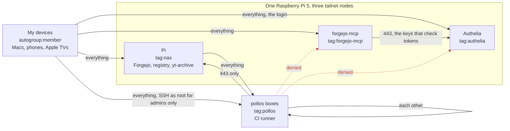

# Who reaches what on the tailnet

The rules live in [`tailscale.tf`](tailscale.tf); this page draws them and says why each one is
there. Change both together.

A rule decides who may **start** a connection. The reply to an allowed one always comes back.
Internet traffic is out of scope: every machine reaches the internet over its own network, not
over the tailnet, so CI jobs still download dependencies from anywhere.

## What it protects against

- **Code that is not mine, running on the pollos boxes.** The runner on them executes CI jobs:
  third-party actions, npm packages with install scripts, dependency bumps from bots. One
  compromised package runs its code on the box. Under the old allow-all policy that code could
  reach every port on every device: the Pi's Postgres and adminer, Forgejo's SSH, the laptops.
  Now it stays on the box, with HTTPS to the Pi and nothing more.
- **A login page as a target.** forgejo-mcp and Authelia both ask for a login, but a login can
  have a bug or be brute-forced. A page a CI job cannot reach cannot be attacked from one. Each
  is a tailnet node of its own because an ACL knows only devices and ports: as paths under the
  Pi's 443, the rule that lets the boxes fetch from the Pi would let them reach these too.

## The picture

## Who may start a connection to whom

| From ↓ / to → | My devices | Pi | pollos boxes | forgejo-mcp | Authelia |
|---|---|---|---|---|---|
| **My devices** | yes | yes | yes, root SSH for admins only | yes, agents call it | yes, to sign in |
| **Pi** | yes | yes | yes | yes, Forgejo checks its issuer | yes |
| **pollos boxes** | no, nothing to fetch there | 443 only: mirrored actions, images, git over HTTPS | yes, the swarm | no | no |
| **forgejo-mcp** | no | no, it reaches Forgejo over Docker's network | no | – | 443 only: the key set it checks tokens with |
| **Authelia** | no | no | no | no | – |

## The rules, and why each exists

| Rule | Why |
|---|---|
| `autogroup:member → *:*` | My own devices run nothing that is not mine. `*:*` also covers `autogroup:internet`, so the exit nodes keep working. It replaced `* → *:*`, which gave the same to every node. |
| `tag:pollos → tag:pollos:*, tag:nas:443` | The CI boxes get what CI really takes from the Pi, the [runner's mirrors](../../forgejo-runner), and each other for the swarm. Git over SSH on 222 is refused on purpose. |
| `tag:nas → *:*` | The Pi is tagged because a Tailscale Service (yt-archive) is hosted only by a tagged device. That took it out of `autogroup:member`, and without this rule it could start nothing, not even Forgejo's check of forgejo-mcp's issuer. |
| `tag:forgejo-mcp → tag:authelia:443` | forgejo-mcp fetches Authelia's discovery document and key set to check every agent's token. It needs nothing else from the tailnet. |
| `grants` for `svc:*` | Built from `local.tailnet_services`: the deploy console and Swarmpit for admins only, since they start deploys; yt-archive for every member. |
| `ssh` | Root on the pollos boxes for `autogroup:admin` only, not every member device. |

To see what one device or user may reach on the live tailnet: the admin console, Access controls,
**Preview rules**.
